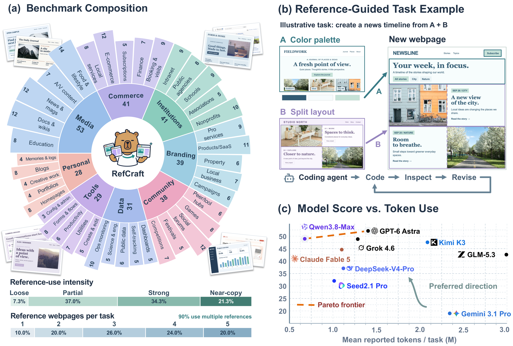

<p align="center"></p>
<h1 align="center">RefCraft</h1>
<p align="center"><strong>Benchmarking Visual-Reference-Conditioned Agentic Generation<br>through Web Development</strong></p>
<p align="center">
  <a href="https://arxiv.org/abs/2610.26826">Paper</a> ·
  <a href="https://wangyuchi369.github.io/refcraft/">Project website</a> ·
  <a href="https://huggingface.co/datasets/YuchiWang/RefCraft">Dataset</a> ·
  <a href="#evaluate">Evaluation</a>
</p>

RefCraft evaluates how coding agents build working webpages from natural-language
instructions and visual references. It includes **300 tasks** in English and
Chinese, each with screenshots from **one to five reference webpages**.

<p align="center"></p>

## Quickstart

Use Python 3.12+ and run the commands below from the repository root.

```bash
git clone https://github.com/wangyuchi369/RefCraft.git
cd RefCraft
python -m venv .venv
source .venv/bin/activate
pip install -r requirements.txt
python -m playwright install chromium
```

### Download data

Download the inputs from [Hugging Face](https://huggingface.co/datasets/YuchiWang/RefCraft).
The evaluation annotations are already included in this repository.

```bash
pip install -U huggingface_hub
hf download YuchiWang/RefCraft bundles/refcraft-inputs.tar.gz --repo-type dataset --local-dir .
tar -xzf bundles/refcraft-inputs.tar.gz
python scripts/export_inputs.py --output ../refcraft-inputs --sample-ids 1,64
```

The exported directory contains the task prompts and ordered reference images.
Give this directory to your agent; keep evaluation annotations out of its workspace.

### Generate webpages

Use your own coding agent, or run the included OpenCode integration with Node.js:

```bash
npm install -g opencode-ai@1.18.25
export REFCRAFT_MODEL_BASE_URL='https://YOUR-PROVIDER/v1'
export REFCRAFT_MODEL_API_KEY='YOUR_API_KEY'
python scripts/generate.py --inputs ../refcraft-inputs --output ../refcraft-run \
  --model YOUR_MODEL_ID --context-limit 200000 --output-limit 32000
```

Replace the provider and model settings with your own. Set context and output
limits to values supported by your model.

### Evaluate

Configure a vision-capable judge, then evaluate the generated webpages:

```bash
export REFCRAFT_JUDGE_BASE_URL='https://YOUR-PROVIDER/v1'
export REFCRAFT_JUDGE_API_KEY='YOUR_API_KEY'
export REFCRAFT_JUDGE_MODEL='YOUR_VISION_MODEL'
python scripts/evaluate.py --responses ../refcraft-run/responses \
  --output runs/my-model --sample-ids 1,64 --model-name YOUR_MODEL_ID
```

For your own agent, point `--responses` to a directory containing
`<task_id>.html` or `<task_id>/index.html`. Task IDs run from 1 to 300.
The commands above use two tasks; omit `--sample-ids` from both export and
evaluation to run all 300. Use a new output directory for each evaluation.

Results are saved to `scores.csv` and `summary.json` in the output directory.
Evaluation combines keypoint fulfillment (B), core functionality (C), and reference
following (R). Overall is the average of each task's minimum applicable component.

## Data format

```text
data/queries.jsonl       Task IDs, requests and ordered reference-image paths
data/references/         Reference screenshots, grouped by task ID
data/keypoints.jsonl     Evaluation criteria, core tests and reference groups
```

Each reference webpage can have several frames. Use all images in their listed
order when running a task.

## Citation

```bibtex
@misc{wang2026refcraft,
  title = {RefCraft: Benchmarking Visual-Reference-Conditioned Agentic Generation through Web Development},
  author = {Yuchi Wang and Rongyao Fang and Weihao Yu and Xilin Wei and Tiancheng Gu and Dingkang Yang and Hang Zhang and Dayiheng Liu and Hongsheng Li and Shuai Bai},
  year = {2026},
  eprint = {2610.26826},
  archivePrefix = {arXiv},
  url = {https://arxiv.org/abs/2610.26826}
}
```

## License

Original code and annotation licensing is pending. See [LICENSE.md](LICENSE.md)
and [reference attribution](docs/attribution.md) for the recorded terms.
